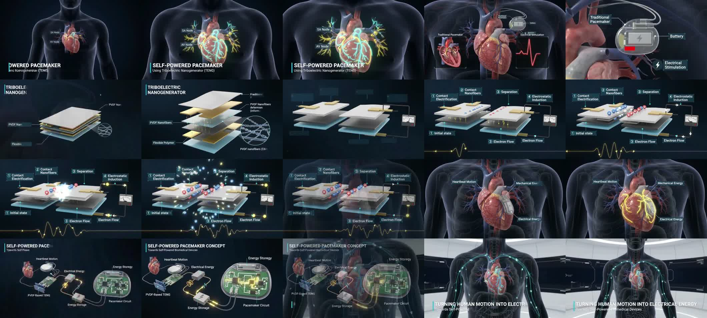

# Reference video → interactive exhibit

## Inspection

The supplied video is 10.027 seconds, 848 × 478, 24 fps, with an audio track. All 20 representative half-second samples (0.0–9.5 s) were reviewed in order, including the final pulled-back scene. The interaction architecture uses the visual sequence, not the video as a runtime scene. The original is retained under `docs/reference/`, outside the published `public/` assets.

Times below are approximate transition ranges from visual frame inspection rather than original editing metadata.

| Time | Reference composition and motion | Interactive translation |
| --- | --- | --- |
| 0.0–1.3 s | Dark frontal translucent torso; heart enlarges in view; cyan/gold conduction routes; SA and AV node annotations; introductory pacemaker title. | Chapter 01: procedural torso shell, ribs, lungs, major vessels, beating heart, conduction pulses, inspectable SA/AV nodes and anatomy, focus/rotate/zoom. |
| 1.3–2.4 s | Closer heart and traditional pacemaker; inset battery and electrical stimulation; camera moves into device. | Chapter 02: selectable conventional battery source versus explicitly experimental motion-harvesting concept; enclosure, battery, pacing lead, and distinct animated supply route. |
| 2.4–3.5 s | Metallic and flexible stacked sheets explode vertically; PVDF nanofiber label and circular magnification of interconnected fibers. | Chapter 03: six rounded, machined sheets with contact tabs, mounting details, conductive materials, transparent backing, active fiber mesh; assembly toggle, per-layer inspection, transparency, fiber focus. |
| 3.5–6.2 s | Contact/separation diagrams; opposing charge signs; gold electron movement and external circuit; analogue meter; gold electrical trace. | Chapter 04: one manipulable 3D contact-separation assembly; four stages; charge distribution and field guides; external electron stream; meter and bipolar qualitative waveform driven by the same displacement state. |
| 6.2–7.5 s | Torso and heart return; harvesting element integrated at heart; gold illuminated routes connect motion and electricity. | Chapter 05 begins with the heart, motion-coupled harvesting element, connected energy-transfer paths, and component inspection. |
| 7.5–8.7 s | Deconstructed energy system; PVDF-based TENG, storage, electronics, magnified circuit board. | Chapter 05 exposes the separate conditioning board, storage block, and pacemaker electronics beside the torso, with click-to-focus explanations. |
| 8.7–10.0 s | Camera pulls back to torso in a futuristic laboratory; cyan pathways and closing human-motion-to-energy message. | Chapter 05 scroll progress pulls the camera back; closing subtitle and permanent emerging-research qualification complete the exhibit. |

## Visual reconstruction decisions

- Near-black navy space, cyan anatomy/electrical guides, warm gold charge signals, fine labels with leader lines, sparse atmospheric points.
- PBR tissue uses original procedural striation bump data; metal has restrained reflections from balanced key, rim, and hemisphere illumination. The torso is actual transparent 3D geometry, not a source-image plane.
- The opening heart is deliberately large enough to inspect; organ-to-body proportions, node locations, tissue shape, and electrical pathways are schematic.
- ScrollTrigger selects the chapters and updates choreography progress. Camera interpolation and generator spread respond continuously to that progress. Free exploration suspends guided camera movement, and selecting/resetting a component always supplies a way back.
- No chapter is implemented by video playback or a static screenshot. There is no video player in the application.

## Scientific boundaries

The video is a visual reference, not clinical validation. Its labels do not establish a complete layer stack, counterpart chemistry, electrode material, dimensions, output waveform, safe attachment method, or energy budget. The six-layer stack expands the visual into an explicitly illustrative assembly.

PVDF is identified because it is named in the reference. Its nanoscale structure is magnified and approximated. Opposing charge signs show a mechanism rather than assigning actual polarity to an unspecified material pair. No fiber dimensions or charge densities are claimed.

A relative electrical response is driven by the rate and direction of a prescribed normalized layer displacement. It is not a circuit solution, a quantitatively predictive TENG model, measured voltage, or power estimate. No clinical performance values are displayed. Conditioning and storage are conceptual necessary blocks rather than a validated electronics design.
